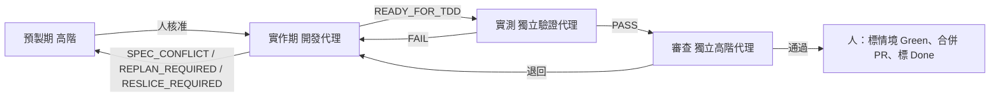

# AI 產品開發總流程（索引）

這份只放**每次都要遵守的原則與流程**。細節放在 `.ai-dev/references/`，**需要時才讀那一份**，不要一次讀全部。規則互相矛盾時以 `.ai-dev/references/decisions.md` 為準。

## 硬性規則（不可違反）
1. **驗證角色絕對不是開發角色**：開發、實測、審查是三個各自啟動的代理，不共用對話。寫某張工單的代理永遠不能實測或審查它；驗證代理不改產品程式與測試。驗收紀錄要寫兩者身分，相同即無效。
2. **完成只能由人標記**：Done、藍燈、Released、`approvedBy` 只有人能設；代理最多把卡片移到 In Review（D1）。
3. **沒有失敗中的測試，就不寫產品程式**；情境與斷言不可為了過關而修改（D5、D6）。
4. **不繞過強制機制**：hook、pre-commit、CI guard、分支保護擋下時照訊息修正，不停用、不改寫指令繞過；需要危險操作交給人。
5. **不留半成品**：Task 只有兩種結局——涵蓋的情境全 GREEN，或回報 `RESLICE_REQUIRED` 並還原。
6. **有證據才放行**：每個關卡都要有證據，不跳步、不偽造結果。

## 角色
- **高階模型**（架構師、審查者）：規劃、切片、審查、診斷卡關根因並寫進失敗經驗文件（`docs/LESSONS.md` 或專案既有的）。
- **中低階模型**（開發者、實測者）：精準實作或實測一張工單，能自行除錯；只有規格矛盾或要改架構時往上回報。
- **人**：核准預製期產出、標情境 Green、合併 PR、標 Done、核准佈署。

## 流程與關卡

1. **預製期** → 執行 `ai-dev-preproduction`。關卡：BDD、測試清單（能跑出有效 RED）、工單齊全且每張一輪可完成、看板已建、人已核准。
2. **派工**：依相依順序，每張工單派一個開發代理執行 `ai-dev-implementation`，能並行的同時派；記下開發代理身分。
3. **回報處理**：`SPEC_CONFLICT`／`REPLAN_REQUIRED`／`RESLICE_REQUIRED` → 暫停該工單，高階模型找根因、修規格、記入失敗經驗後重派；`RESLICE_REQUIRED` 退回 Backlog 灰燈（D11）。
4. **驗收期**：工單 `READY_FOR_TDD` 後，**另外啟動**驗證代理與審查代理執行 `ai-dev-pr-acceptance`。
5. 退回就帶證據回第 2 步；同一張退回兩次以上，高階模型親自診斷並給具體解法（不是只叫它重試）。
6. 全部完成後向人回報：完成的工單、PR 連結、證據位置、新學到的失敗經驗、未解問題，並問要不要規劃下一批。

## 狀態碼
| 狀態碼 | 誰發 | 意思 | 看板 |
|---|---|---|---|
| `READY_FOR_TDD` | 開發代理 | 涵蓋情境全 GREEN，可驗收 | In Review |
| `SPEC_CONFLICT` | 開發代理 | 規格互相矛盾 | 黃／紅燈＋原因 |
| `REPLAN_REQUIRED` | 開發代理 | 要新增介面、跨層或改架構 | 黃／紅燈＋原因 |
| `RESLICE_REQUIRED` | 開發代理 | 一輪做不完 | 退回 Backlog 灰燈 |

## 遇到什麼就讀哪份（`.ai-dev/references/`）
| 情況 | 讀 |
|---|---|
| 規則互相矛盾、不確定以哪個為準 | `decisions.md` |
| 建卡、移卡、燈號、history、被 L1–L7 擋 | `board-and-lights.md` |
| 領單、MCP／API、token、送審、情境狀態端點 | `board-agent-api.md` |
| 被 hook／pre-commit／CI guard 擋、commit 失敗、worktree 問題 | `enforcement-and-pitfalls.md` |
| 寫情境、測試清單、Red→Green 證據 | `bdd-tdd.md` |
| 需求、UX、拆 Story／Task、切片 | `planning.md` |
| 選架構、程式該放哪一層 | `architecture.md` |
| 寫程式、自我審查、註解 | `clean-code.md` |
| 熱點、大輸入、優化、記憶體 | `performance-memory.md` |
| 外部輸入、權限、密碼、錯誤回應、套件 | `security.md` |
| 測試層級、交易、併發、日誌 | `testing-data-observability.md` |
| 分支、commit、衝突、版本、佈署、回滾 | `release-deploy.md` |
| 這個專案用什麼指令 | `stack-commands.md` |
| 擔任實測或審查代理 | `verification.md` |

## 看板一句話
看板檔在 `<boardPath>`（看 `.ai-pm/project.json`；GuGuBoard 本身是 `docs/board.json`）。優先用 GuGuBoard MCP 工具改，每次變更都寫 reason 並追加 history（D9、D10）。
